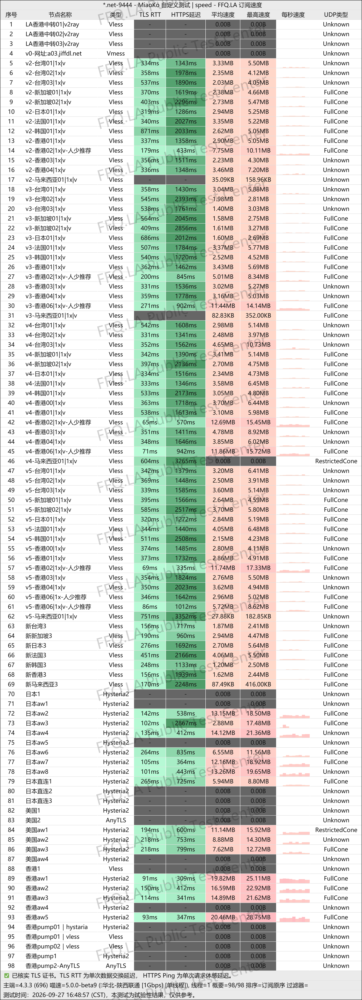
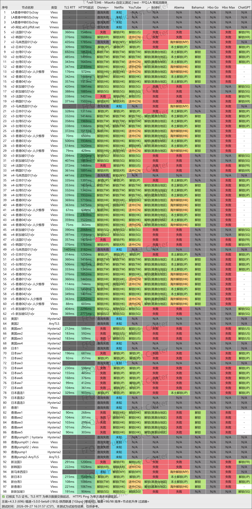
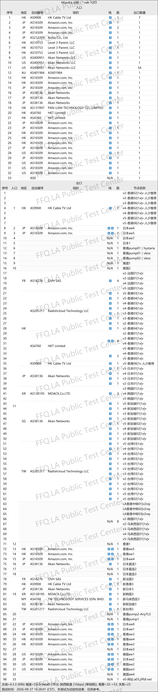

🇨🇳 [中文](README.md) | 🇺🇸 English | 🇷🇺 [Русский](README_RU.md) | 🇮🇷 [فارسی](README_FA.md)

# JFCloud VPN Official Website (Updated November 4, 2026)

Official JFCloud VPN Website<br>
Latest URL: [j134.net](https://to.iix.im/jf01)<br>
Official URL: [homes.jif9.net](https://to.iix.im/jf02)<br>

Best VPN Recommendations and Server List for 2026: [https://github.com/jdnei/JiChangTuiJian](https://github.com/jdnei/JiChangTuiJian)<br>

## Telegram VPN Deals & Community #AD
[VPN Giveaways](https://331024.de/archives/choujiang) | [VPN Chat Group](https://331024.de/archives/choujiang) | [VPN Trial Group](https://331024.de/archives/choujiang)<br>

[https://331024.de/archives/choujiang](https://331024.de/archives/choujiang)

## Invitation Code
```bash
EACg
```

## Promo Code / Discount Code
`35% OFF | Valid for 3 days after registering through an invitation`

```bash
jff5165
```

## Overview
JFCloud VPN is a VPN service focused on affordability and reliable dedicated-line connections. It uses BGP relay servers and IPLC dedicated-line networks, with server locations covering Hong Kong, Japan, Taiwan, Singapore, the United States, South Korea, and other popular regions.

The service supports major VPN clients, including Clash, Shadowrocket, and V2Ray, making it suitable for everyday web browsing, video streaming, and accessing AI services.

## Advantages
JFCloud VPN focuses on affordable pricing, generous data allowances, and stable dedicated-line connections.

All servers use a standard 1× traffic multiplier, meaning data usage is counted at its actual rate. Some subscription plans also allow users to earn additional data through daily check-ins.

Network routes are optimized for connections from mainland China, providing reliable access to popular streaming platforms such as Netflix and Disney+, as well as AI services including ChatGPT.

With broad client compatibility and affordable subscription options, JFCloud VPN is a practical choice for long-term everyday use.

## Pricing Plans

| Plan | Price | Data Allowance | Concurrent Devices | Maximum Speed | Mainland China Relay | Streaming Unblocking | IPLC Dedicated Lines | Server Access |
| --- | ---: | ---: | ---: | ---: | :---: | :---: | :---: | --- |
| Basic | ¥24.99/month | 100 GB | 3 | Up to 60 Mbps | ✅ | ✅ | ✅ | Entry, Basic, Standard, Premium, Flagship (All Servers) |
| Standard | ¥39.99/month | 200 GB | 3 | Up to 150 Mbps | ✅ | ✅ | ✅ | Entry, Basic, Standard, Premium, Flagship (All Servers) |
| Premium | ¥49.99/month | 350 GB | 5 | Up to 300 Mbps | ✅ | ✅ | ✅ | Entry, Basic, Standard, Premium, Flagship (All Servers) |
| Flagship | ¥79.99/month | 600 GB | 8 | Unlimited | ✅ | ✅ | ✅ | Entry, Basic, Standard, Premium, Flagship (All Servers) |
| Flagship Extra Data | ¥119.99/month | 1200 GB | 10 | Unlimited | ✅ | ✅ | ✅ | Entry, Basic, Standard, Premium, Flagship (All Servers) |

## 📊 Performance Tests & Analysis

#### 1. Evening Peak-Hour Speed Test
<br>

#### 2. Streaming Service Unblocking Report
<br>

#### 3. Entry and Exit Node Analysis
<br>
