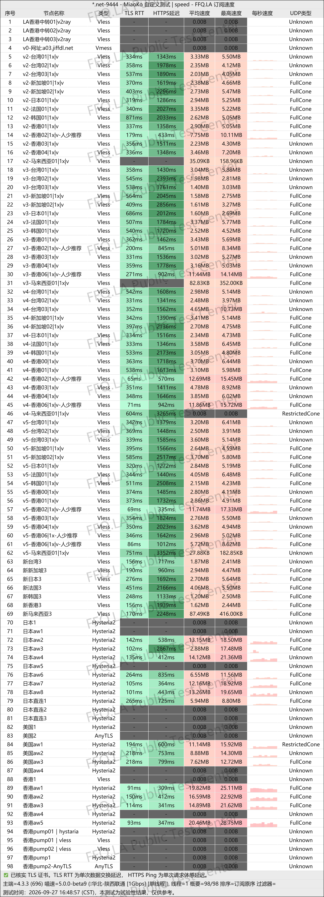
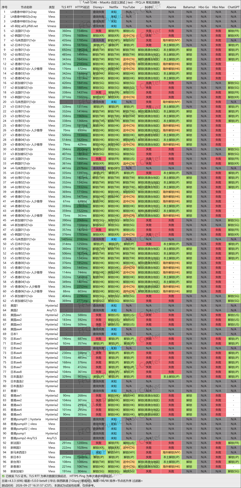
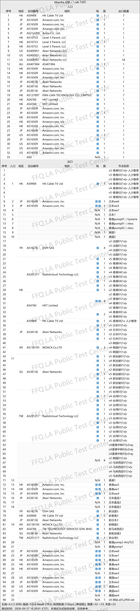

 🇨🇳 [中文](README.md) | 🇺🇸 [English](README_EN.md) | 🇷🇺 [Русский](README_RU.md) | 🇮🇷 فارسی

# وب‌سایت رسمی JFCloud VPN (به‌روزرسانی ۱ نوامبر ۲۰۲۶)

وب‌سایت رسمی JFCloud VPN<br>
آخرین آدرس: [j134.net](https://to.iix.im/jf01)<br>
آدرس رسمی: [homes.jif9.net](https://to.iix.im/jf02)<br>

معرفی بهترین سرویس‌ها و سرورهای VPN در سال ۲۰۲۶: [https://github.com/jdnei/JiChangTuiJian](https://github.com/jdnei/JiChangTuiJian)<br>

## انجمن و پیشنهادهای ویژه VPN در تلگرام #AD
[قرعه‌کشی VPN](https://331024.de/archives/choujiang) | [گروه گفت‌وگوی VPN](https://331024.de/archives/choujiang) | [گروه آزمایش VPN](https://331024.de/archives/choujiang)<br>

[https://331024.de/archives/choujiang](https://331024.de/archives/choujiang)

## کد دعوت
```bash
EACg
```

## کد تخفیف
`۳۵٪ تخفیف | معتبر تا ۳ روز پس از ثبت‌نام از طریق دعوت‌نامه`

```bash
jff5165
```

## معرفی
JFCloud VPN یک سرویس VPN است که بر قیمت مناسب و اتصال پایدار از طریق خطوط اختصاصی تمرکز دارد.

این سرویس از سرورهای واسط BGP و شبکه خطوط اختصاصی IPLC استفاده می‌کند. سرورهای آن در مناطق پرکاربردی مانند هنگ‌کنگ، ژاپن، تایوان، سنگاپور، ایالات متحده آمریکا، کره جنوبی و سایر مناطق قرار دارند.

JFCloud VPN از کلاینت‌های محبوب VPN مانند Clash، Shadowrocket و V2Ray پشتیبانی می‌کند و برای مرور روزمره وب، تماشای ویدئوهای آنلاین و استفاده از خدمات هوش مصنوعی مناسب است.

## مزایا
مهم‌ترین مزایای JFCloud VPN شامل قیمت پایین، حجم بالای ترافیک و پایداری اتصال از طریق خطوط اختصاصی است.

تمام سرورها از ضریب محاسبه ترافیک ۱× استفاده می‌کنند؛ به این معنی که حجم مصرفی بدون ضریب اضافی محاسبه می‌شود. برخی از طرح‌های اشتراک نیز امکان دریافت ترافیک اضافی از طریق ثبت حضور روزانه در حساب کاربری را فراهم می‌کنند.

مسیرهای شبکه برای اتصال از سرزمین اصلی چین بهینه‌سازی شده‌اند. این سرویس از رفع محدودیت پلتفرم‌های محبوب پخش آنلاین مانند Netflix و Disney+ و همچنین خدمات هوش مصنوعی مانند ChatGPT پشتیبانی می‌کند.

به دلیل سازگاری با پلتفرم‌های مختلف و ارائه طرح‌های مقرون‌به‌صرفه، JFCloud VPN گزینه‌ای مناسب برای استفاده پایدار و بلندمدت روزانه است.

## طرح‌های اشتراک

| طرح | قیمت | حجم ترافیک | دستگاه‌های هم‌زمان | حداکثر سرعت | سرور واسط در چین | رفع محدودیت استریم | خطوط اختصاصی IPLC | دسترسی به سرورها |
| --- | ---: | ---: | ---: | ---: | :---: | :---: | :---: | --- |
| پایه | ¥24.99/ماه | 100 GB | 3 | تا 60 Mbps | ✅ | ✅ | ✅ | مقدماتی، پایه، استاندارد، پیشرفته، پرچم‌دار (تمام سرورها) |
| استاندارد | ¥39.99/ماه | 200 GB | 3 | تا 150 Mbps | ✅ | ✅ | ✅ | مقدماتی، پایه، استاندارد، پیشرفته، پرچم‌دار (تمام سرورها) |
| پیشرفته | ¥49.99/ماه | 350 GB | 5 | تا 300 Mbps | ✅ | ✅ | ✅ | مقدماتی، پایه، استاندارد، پیشرفته، پرچم‌دار (تمام سرورها) |
| پرچم‌دار | ¥79.99/ماه | 600 GB | 8 | نامحدود | ✅ | ✅ | ✅ | مقدماتی، پایه، استاندارد، پیشرفته، پرچم‌دار (تمام سرورها) |
| پرچم‌دار با حجم بالا | ¥119.99/ماه | 1200 GB | 10 | نامحدود | ✅ | ✅ | ✅ | مقدماتی، پایه، استاندارد، پیشرفته، پرچم‌دار (تمام سرورها) |

## 📊 آزمایش عملکرد و تحلیل

#### 1. آزمایش سرعت در ساعات اوج مصرف شبانه
<br>

#### 2. گزارش رفع محدودیت سرویس‌های پخش آنلاین
<br>

#### 3. تحلیل سرورهای ورودی و خروجی
<br>
