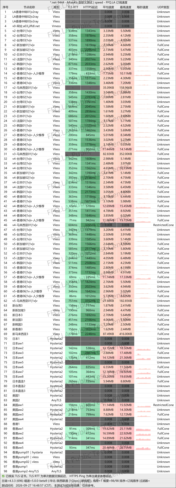
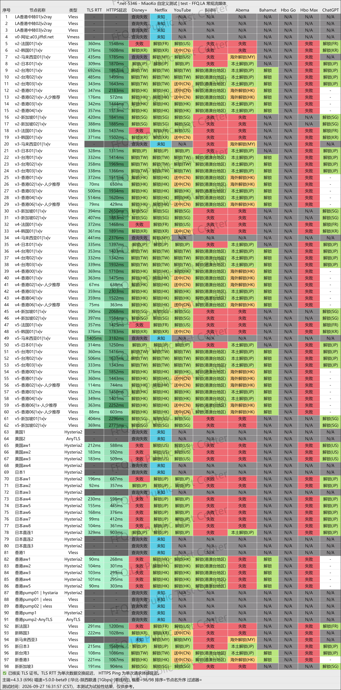
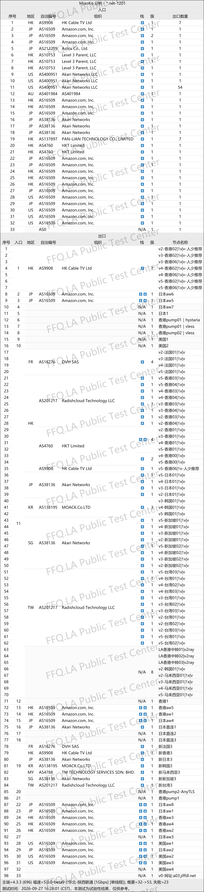

🇨🇳 [中文](README.md) | 🇺🇸 [English](README_EN.md) | 🇷🇺 Русский | 🇮🇷 [فارسی](README_FA.md)

# Официальный сайт JFCloud VPN (обновлено 9 ноября 2026)

Официальный сайт JFCloud VPN<br>
Актуальный адрес: [j134.net](https://to.iix.im/jf01)<br>
Официальный адрес: [homes.jif9.net](https://to.iix.im/jf02)<br>

Лучшие VPN-сервисы и серверы на 2026 год: [https://github.com/jdnei/JiChangTuiJian](https://github.com/jdnei/JiChangTuiJian)<br>

## Telegram: VPN-сообщество и специальные предложения #AD
[Розыгрыши VPN](https://331024.de/archives/choujiang) | [Чат о VPN](https://331024.de/archives/choujiang) | [Группа тестирования VPN](https://331024.de/archives/choujiang)<br>

[https://331024.de/archives/choujiang](https://331024.de/archives/choujiang)

## Пригласительный код
```bash
EACg
```

## Промокод / Код скидки
`Скидка 35% | Действует 3 дня после регистрации по приглашению`

```bash
jff5165
```

## Обзор
JFCloud VPN — VPN-сервис, ориентированный на доступные цены и стабильные соединения через выделенные линии.

Сервис использует промежуточные серверы BGP и выделенные линии IPLC. Серверная инфраструктура охватывает популярные регионы, включая Гонконг, Японию, Тайвань, Сингапур, США, Южную Корею и другие страны.

Поддерживаются основные VPN-клиенты, такие как Clash, Shadowrocket и V2Ray. Сервис подходит для повседневного просмотра веб-сайтов, потокового видео и использования сервисов искусственного интеллекта.

## Преимущества
Главные преимущества JFCloud VPN — низкие цены, большие объёмы трафика и стабильные соединения через выделенные линии.

На всех серверах применяется коэффициент учёта трафика 1×, то есть фактически использованный трафик списывается без дополнительного множителя. Некоторые тарифные планы также позволяют получать дополнительный трафик за ежедневную отметку в личном кабинете.

Сетевые маршруты оптимизированы для подключения из материкового Китая. Сервис поддерживает разблокировку популярных стриминговых платформ, включая Netflix и Disney+, а также AI-сервисов, таких как ChatGPT.

Благодаря совместимости с различными платформами и доступным тарифам JFCloud VPN подходит для стабильного повседневного использования на протяжении длительного времени.

## Тарифные планы

| Тариф | Цена | Трафик | Одновременные устройства | Максимальная скорость | Ретрансляция через Китай | Разблокировка стриминга | Выделенные линии IPLC | Доступные серверы |
| --- | ---: | ---: | ---: | ---: | :---: | :---: | :---: | --- |
| Базовый | ¥24.99/мес. | 100 ГБ | 3 | До 60 Мбит/с | ✅ | ✅ | ✅ | Начальный, Базовый, Стандартный, Премиум, Флагманский (все серверы) |
| Стандартный | ¥39.99/мес. | 200 ГБ | 3 | До 150 Мбит/с | ✅ | ✅ | ✅ | Начальный, Базовый, Стандартный, Премиум, Флагманский (все серверы) |
| Премиум | ¥49.99/мес. | 350 ГБ | 5 | До 300 Мбит/с | ✅ | ✅ | ✅ | Начальный, Базовый, Стандартный, Премиум, Флагманский (все серверы) |
| Флагманский | ¥79.99/мес. | 600 ГБ | 8 | Без ограничений | ✅ | ✅ | ✅ | Начальный, Базовый, Стандартный, Премиум, Флагманский (все серверы) |
| Флагманский с увеличенным трафиком | ¥119.99/мес. | 1200 ГБ | 10 | Без ограничений | ✅ | ✅ | ✅ | Начальный, Базовый, Стандартный, Премиум, Флагманский (все серверы) |

## 📊 Тесты производительности и анализ

#### 1. Тест скорости в вечерние часы пик
<br>

#### 2. Отчёт о разблокировке стриминговых сервисов
<br>

#### 3. Анализ входных и выходных узлов
<br>
